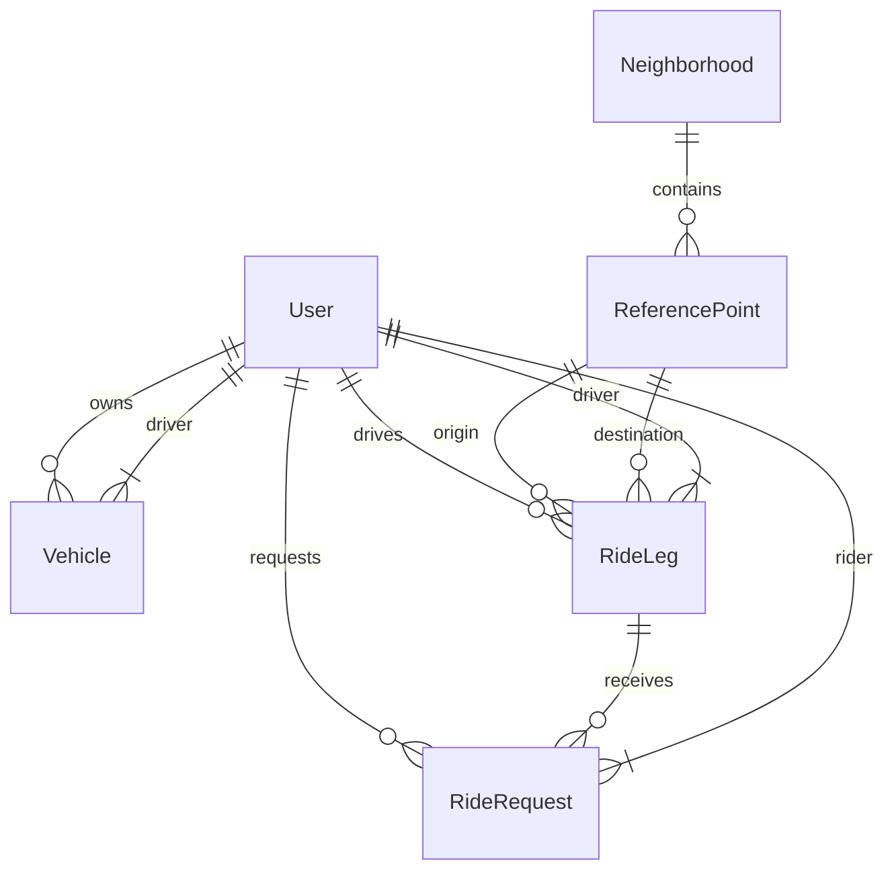

# 🛠️ Architecture / SSD

**Projeto:** Caronas UTFPR
**Versão:** 1.0.0 · definido via `/utf-architecture`
**Última atualização:** 2026-10-10

> 🤖 **O `prd.md` responde _o quê_ o produto faz. Este responde _onde as coisas
> moram e como se chamam_.** Detalhe de tela — rota, componente, contrato —
> **não** se decide aqui: isso é trabalho da spec de cada história.
> (No texto oficial da disciplina este documento é o `ssd.md` — ID31.)
>
> ✍️ **Não preencha na mão:** rode `/utf-architecture` (depois do `/utf-prd`).
> A entrevista decide com você cada seção e garante o que o `/utf-setup` exige:
> **framework do frontend, o BaaS, a estrutura do projeto e como rodar os
> testes.**

---

## 🤖 1. Fontes de Contexto para a IA

> Onde a IDE agêntica busca a verdade. **Isto é o índice; a configuração mora
> nos arquivos** — documento não configura ferramenta.

| Fonte | Onde configurar | Serve para |
| :---- | :-------------- | :--------- |
| Constituição da IA | `.agents/rules/utf-rules.md` (via `CLAUDE.md`) | Regras inegociáveis: fases do SDD, 2 rodadas, revisores distintos, Gitflow |
| Fluxos da IA | `.agents/workflows/` | PRD, backlog, design, architecture, setup, ciclo por Issue, ciclo por tarefa, tutor |
| Agentes (subagentes) | `.agents/agents/` (cascas em `.claude/`, `.cursor/`, `.opencode/`) | Implementador, revisores, auditor final e tutor |
| Ficha da disciplina | `docs/checklist.md` | Regras do projeto, IDs e entregas |
| Protótipo (Stitch/Figma) | https://stitch.withgoogle.com/projects/18188893525436397761 / https://www.figma.com/design/sGZhxiiZS7xKHRMMemq12L/Munte-App?node-id=1-212&t=UaY3ydqlr5EiowMd-1 | Telas, jornadas e hierarquia visual (ID1) |
| MCPs da IDE | Context7, Supabase, Figma | Contexto exato do projeto para o agente (ID32) |

---

## 📦 2. Stack Tecnológica

> Definição **estrita**: nenhuma dependência entra sem aparecer aqui. Esta
> seção e o `package.json` contam a mesma história, ou o projeto já se perdeu.
> O que a ficha fixa entra como está; o que ela deixa livre é decidido na
> entrevista.

- **Frontend:** **Angular 21** — standalone, signals, zoneless (conforme a versão).
- **Padrões de código exigidos** (a ficha cobra cada um — IDs 4, 6, 7, 9, 10–15):
  `@if`/`@switch`, `@for` com `track`, `@defer`, signals (writable/computed) como
  fonte de estado, `model()` para two-way, `effect()` para efeitos colaterais,
  `input()`/`output()`, `inject()`, Pipes para formatação.
- **Framework CSS:** **Tailwind CSS** (ID5) — configuração em `tailwind.config.ts`.
- **Dados (em duas fases):** **json-server** no MVP (E2) → **Supabase** na E3, com autenticação (JWT) e CRUD reais (IDs 21–22). A troca atinge só os Services (§2.1).
- **PWA:** `manifest.webmanifest` — ícones, cores de tema, splash, standalone, offline (ID3). Valores em `docs/design-tokens.md`.
- **Testes:** **Vitest** (unitário, padrão do Angular 21) + **Playwright** (E2E) + comandos exatos de suíte e lint (ID33).

### 🌐 2.1. Camada de dados — regras estruturais

> Declaradas uma a uma na entrevista, percorrendo os IDs da ficha.

- **Componente não fala com o servidor:** todo acesso a dados passa por
  **Services** injetados via `inject()` (ID15) — mudança de contrato mexe só
  neles, nunca nas telas. **É esta regra que paga a migração da E3:** trocar o
  json-server pelo Supabase reescreve os Services, e nenhuma tela.
- **Autenticação e sessão (JWT):** Supabase Auth — fluxo: login → access token →
  Functional Interceptor injeta globalmente → refresh automático (ID21, ID23).
- **Interceptors funcionais:** token injetado globalmente + tratamento
  centralizado de erros (ID23). Configuração via `provideHttpClient(withInterceptors([...]))`.
- **Assíncrono ↔ reativo:** `toSignal()`/`toObservable()` na fronteira entre
  RxJS e signals (ID25). Services expõem `signal()`/`computed()`; internamente usam `HttpClient` + `toSignal()`.
- **Formulários Reativos** com validação, mensagens claras e submit
  desabilitado quando inválido (ID24). `FormGroup`/`FormControl` + validadores + binding via `model()`.

---

## 🗂️ 3. Estrutura do Projeto

```text
.
├── .agents/               # constituição, workflows e prompts dos agentes (§1)
├── CLAUDE.md / AGENTS.md  # cascas por ferramenta (.claude/, .cursor/, .opencode/)
├── README.md              # a vitrine, na estrutura exigida pela ficha
├── docs/                  # prd.md, este arquivo, design-tokens.md, checklist.md e guias
├── specs/                 # uma pasta por história implementada
└── apps/
    ├── web/               # o app Angular — package.json próprio
    └── api/               # reservada para uma API real, se um dia existir
```

> 📌 **Por que `apps/` com duas pastas se só uma tem código.** Nesta disciplina os
> dados vêm do json-server e depois do BaaS: não há backend para escrever. Mas a
> casca do monorepo custa nada agora e evita mover o projeto inteiro no dia em que
> uma API própria fizer sentido. **`apps/api/` nasce vazia, e continua vazia** — o
> setup não gera backend nenhum; ela só guarda o lugar (e o `db.json` do
> json-server, se o documento assim declarar).

### Organização interna do app (`apps/web/src/app/` — feature-driven)

```
src/app/
├── core/                  # Singletons: Services de dados, Guards, Interceptors
│   ├── services/          # RideService, AuthService, NotificationService, UserService
│   ├── guards/            # authGuard, roleGuard (Functional Guards)
│   └── interceptors/      # authInterceptor, errorInterceptor (Functional Interceptors)
├── shared/                # Componentes burros (dumb), Pipes, Diretivas utilitárias
│   ├── components/        # Button, Card, Input, Modal, Chip, Avatar, Spinner, EmptyState
│   ├── pipes/             # rideStatus, timeAgo, seatCount, currencyBr
│   └── directives/        # clickOutside, focusTrap, autoResize
└── features/              # Uma pasta por domínio (não se importam entre si)
    ├── auth/              # Login, registro, recuperação de senha, perfil
    ├── rides/             # Ofertas (criar/listar/detalhar), solicitações, minhas caronas
    ├── notifications/     # Sino, centro de notificações, preferências
    └── profile/           # Perfil do usuário, veículo, preferências
```

**Regra de dependência (estrita):**
- `core/` → pode ser importado por `shared/` e `features/`
- `shared/` → pode ser importado por `features/`
- `features/` → **não importam umas das outras** (comunicação via Services em `core/` ou eventos)

---

## 🧭 4. Roteamento e Navegação

> A ficha cobra a API funcional moderna (IDs 16–19): `provideRouter` com
> `withComponentInputBinding()`, parâmetros de rota via Signal `input()`,
> rotas filhas para hierarquia de layout, Functional Guards e Resolvers.

**Configuração base (`app.config.ts`):**
```ts
provideRouter(routes, withComponentInputBinding())
```

**Estrutura de rotas (inicial — cresce por história):**
- `/` → `HomeComponent` (shell com header, sino, navegação)
  - `/rides` → `RidesShellComponent` (layout com sidebar)
    - `/rides/offer` → `RideOfferComponent` (criar oferta) — `canActivate: [authGuard]`
    - `/rides/search` → `RideSearchComponent` (buscar/filtros)
    - `/rides/:id` → `RideDetailComponent` — `resolve: { ride: rideResolver }`
  - `/my-rides` → `MyRidesComponent` — `canActivate: [authGuard]`
  - `/notifications` → `NotificationsComponent` — `canActivate: [authGuard]`
  - `/profile` → `ProfileComponent` — `canActivate: [authGuard]`
- `/auth` → `AuthShellComponent`
  - `/auth/login` → `LoginComponent`
  - `/auth/callback` → `AuthCallbackComponent`

**Padrões obrigatórios:**
- Parâmetros de rota consumidos via `input()` Signal no componente destino (ID17): `rideId = input.required<string>()`
- Rotas filhas (`children: []`) para hierarquia de layout (ID18)
- Functional Guards para autenticação/autorização (ID19)
- Resolvers para pré-carregamento de dados antes da transição (ID19)

---

## 🗄️ 5. Arquitetura de Dados (BaaS)

### 📖 5.1. Glossário Técnico (Mapeamento)

> A ponte entre o português do negócio (PRD §2) e o inglês do código.
> **Dados e código em inglês, interface em português.**

| Termo PRD (PT-BR) | Entidade/Tabela (EN) | Atributos principais |
| :---------------- | :------------------- | :------------------- |
| Comunidade UTFPR / Usuário autenticado | `User` | `id`, `name`, `email`, `role` (student/teacher), `utfappsId`, `campus`, `createdAt` |
| Motorista | `Driver` (role em `User`) | `vehicleId`, `rating`, `totalRides` |
| Carona / Passageiro | `Rider` (role em `User`) | `preferences`, `rating` |
| Ida | `RideLeg` | `id`, `driverId`, `originPointId`, `destinationPointId` (UTFPR fixo), `departureTime`, `seatsTotal`, `seatsAvailable`, `status` (available/full/cancelled/completed) |
| Volta | `RideLeg` | Mesmo schema — `originPointId` = UTFPR, `destinationPointId` = ponto no bairro |
| Ponto de referência | `ReferencePoint` | `id`, `neighborhoodId`, `name`, `lat`, `lng`, `order` (1..3) |
| Vaga | (atributo de `RideLeg`) | `seatsTotal`, `seatsAvailable` |
| Solicitação | `RideRequest` | `id`, `riderId`, `rideLegId`, `status` (pending/accepted/rejected/cancelled), `createdAt` |
| Match / Aceite | (transição de `RideRequest.status`) | `acceptedAt`, `acceptedBy` |
| Cancelamento | (transição de `RideRequest.status` ou `RideLeg.status`) | `cancelledAt`, `cancelledBy`, `reason` |
| Bairro | `Neighborhood` | `id`, `name`, `city` (UTFPR campus) |
| Veículo | `Vehicle` | `id`, `driverId`, `plate`, `model`, `color`, `capacity` |

> **Nota:** `Driver` e `Rider` são *roles* do `User` (campo `role` + profile estendido), não tabelas separadas.

### 📊 5.2. Diagrama ER (Mermaid)

> As tabelas do BaaS e seus relacionamentos — o mesmo diagrama vai renderizado
> no README, como a ficha exige.



### 🔒 5.3. Segredos, Ambientes e Contrato dos Dados

> Chaves do BaaS: a *anon key* pública vive em `environment.ts` (é pública por
> design — a segurança vem das regras de acesso do BaaS, ex.: RLS no Supabase);
> **service keys e segredos nunca entram no repositório**.

| Fase | App roda em | Dados |
| :--- | :--- | :--- |
| **Local (E2/MVP)** | `ng serve` | json-server (`apps/api/db.json`) |
| **Local (E3)** | `ng serve` | Supabase (projeto de dev) |
| **Produção (E3)** | Vercel/Render | Supabase (projeto de produção) |

**Contrato dos dados:**
- **MVP (E2):** `apps/api/db.json` — JSON plano espelhando o ER acima. O json-server expõe REST automático.
- **E3:** Schema do **Supabase** (PostgreSQL + RLS). Mesmas entidades, migração via scripts SQL.
- **Regra de ouro:** A troca de fonte de dados atinge **apenas os Services em `core/services/`** — componentes, guards, interceptors, rotas não mudam.

---

## 📋 6. Padrões Estruturais Cobrados pelos IDs

> Declaração explícita para cada ID da ficha que exige padrão de código ou infraestrutura. É esta declaração que os revisores usam como critério fixo.

| ID | Padrão Arquitetural Declarado |
|----|-------------------------------|
| **ID4** | Componentes **standalone only** — zero `NgModule` em todo o projeto |
| **ID5** | Framework CSS: **Tailwind CSS** — configuração em `tailwind.config.ts`, tokens em `docs/design-tokens.md` |
| **ID6** | Controle de fluxo: **`@if` / `@switch`** — proibido `*ngIf`/`*ngSwitch`/`*ngSwitchCase` |
| **ID7** | Loop: **`@for` com `track` obrigatório** — ex.: `@for (ride of rides(); track ride.id)` |
| **ID8** | Pipes: **nativos (date, currency, json) + custom** em `shared/pipes/` (ex.: `rideStatus`, `timeAgo`, `seatCount`, `currencyBr`) |
| **ID9** | **`@defer`** para componentes pesados (mapa, charts, editor) — trigger `on viewport` ou `on interaction` |
| **ID10** | Estado: **Signals only** — `signal()` (writable) + `computed()` — proibido `BehaviorSubject`/RxJS no estado de UI |
| **ID11** | Event binding: **`(click)` / `(submit)` / `(change)`** → handlers atualizam signals |
| **ID12** | Two-way binding: **`model()`** em componentes — ex.: `<input [model]="searchTerm()">` |
| **ID13** | Side effects: **`effect(() => { ... })`** — logging, analytics, persistência local, sincronização |
| **ID14** | Comunicação pai/filho: **`input()` + `output()`** tipadas — sem `@Input()`/`@Output()` decorators |
| **ID15** | Comunicação não-hierárquica: **Services em `core/services/` + `inject()`** — ex.: `RideService`, `AuthService`, `NotificationService`, `UserService` |
| **ID16** | Roteamento: **`provideRouter(routes, withComponentInputBinding())`** em `app.config.ts` |
| **ID17** | Parâmetros de rota: **`input()` Signal** no componente destino — ex.: `rideId = input.required<string>()` |
| **ID18** | Rotas filhas: **Nested routes** para layout com shell (header, sidebar, sino) — `children: []` |
| **ID19** | Guards/Resolvers: **Functional** — `canActivate: [authGuard]`, `resolve: { ride: rideResolver }` |
| **ID20** | GET assíncrono: **`HttpClient` + `toSignal()`** em Services — ex.: `rides = toSignal(http.get<RideLeg[]>('/rides'))` |
| **ID21** | Auth JWT: **Supabase Auth** — login → access token → Functional Interceptor injeta → refresh automático via Supabase client |
| **ID22** | CRUD: **Services expõem `signal()`/`computed()`** — internamente `HttpClient` (MVP) ou Supabase client (E3) + `toSignal()`; BaaS client encapsulado no Service |
| **ID23** | Interceptors: **Functional** — `provideHttpClient(withInterceptors([authInterceptor, errorInterceptor]))` |
| **ID24** | Forms: **Reactive Forms** — `FormGroup`/`FormControl` + validadores síncronos/assíncronos + `model()` binding + submit desabilitado se `form.invalid` |
| **ID25** | Ponte async/reativo: **`toSignal(observable)` / `toObservable(signal)`** na borda dos Services (camada de dados) |

---

## 🗺️ 7. Mapa de Domínios e Rotas

> **Este índice cresce.** Não é para preencher agora: **uma linha por história
> implementada** — a spec é que define rota e contrato. Aqui fica só o mapa de
> quem já existe.

| Domínio | Rota | Guard | Dados (service) | US |
| :------ | :--- | :---- | :-------------- | :-- |
| *(vazio — preenchido conforme histórias forem implementadas)* | | | | |

---

## 📅 8. Histórico

| Data | Versão | O que mudou |
| :--- | :----- | :---------- |
| 2026-10-10 | 1.0.0 | Versão inicial via `/utf-architecture` — Angular 21, Supabase, Vitest/Playwright, Tailwind, estrutura feature-driven |

---

## 🛑 O que ainda **não** está neste documento

Detalhes de funcionalidade — contratos de uma tela específica, máquinas de
estado de uma história — **não entram aqui**: nascem sob demanda no `spec.md`
de cada história. Este documento guarda só o que vale para o sistema inteiro.