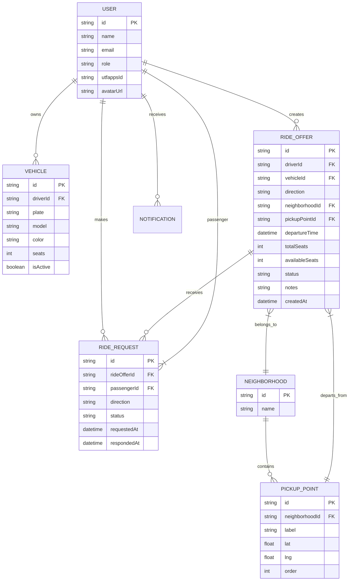

# 🏗️ Architecture Decision Record (ADR) — Caronas UTFPR

**Projeto:** Caronas UTFPR
**Versão:** 1.0.0 · definido via `/utf-architecture`
**Última atualização:** 2026-10-11

> 🤖 **Este documento é a régua técnica do semestre.** O `/utf-setup`, os implementadores e os revisores consultam aqui. Dependência que não estiver aqui não entra no projeto.

---

## 1. Frontend — Angular 20+ (Standalone)

**Linha de versão:** `Angular 20+` (número exato no `package.json`)

### Padrões obrigatórios

| Padrão | Descrição |
|--------|-----------|
| **Standalone Components** | Padrão atual — não se escreve `standalone: true` |
| **Signals** | Estado reativo via `signal()` (writable) e `computed()` |
| **Control Flow** | `@if` / `@for` / `@switch` / `@defer` (não `*ngIf`/`*ngFor`) |
| **Input/Output** | `input()` / `output()` / `model()` como funções |
| **Dependency Injection** | `inject()` (não injeção via construtor) |
| **Lazy Loading** | Por rota de feature (`loadComponent`, `loadChildren`) |
| **Data Layer Rule** | **Componente não fala com servidor** — todo acesso à API passa por Service/Repository; mudança de contrato mexe só nessa camada |

---

## 2. Fonte de Dados — Por Fase

| Fase | Tecnologia | Localização | Observação |
|------|------------|-------------|------------|
| **MVP (Entrega 2)** | `json-server` | `apps/api/db.json` | API fake local na porta 3001 |
| **Entrega 3** | **Supabase** (BaaS) | Cloud (projeto Supabase da equipe) | Auth JWT + Postgres real + Realtime |

**Regra de migração:** A troca de `json-server` → Supabase atinge **apenas os Services** em `apps/web/src/app/core/services/`. Componentes, guards, interceptors não mudam.

---

## 3. Testes — Ferramentas e Comandos

| Camada | Ferramenta | Comando (em `apps/web`) |
|--------|------------|-------------------------|
| Unit / Integration | **Vitest** + `@angular/testing` + `@testing-library/angular` | `npm run test` (watch) / `npm run test:ci` (CI + coverage) |
| E2E | **Playwright** | `npm run e2e` (UI) / `npm run e2e:ci` (headless CI) |
| Lint / Format | **ESLint** + `@angular-eslint` + **Prettier** | `npm run lint` / `npm run format` |

**Scripts raiz (`package.json` na raiz do repo):**
```json
{
  "scripts": {
    "api": "json-server --watch apps/api/db.json --port 3001",
    "dev": "concurrently \"npm run api\" \"npm run start --prefix apps/web\"",
    "test": "npm run test --prefix apps/web",
    "test:ci": "npm run test:ci --prefix apps/web",
    "e2e": "npm run e2e --prefix apps/web",
    "e2e:ci": "npm run e2e:ci --prefix apps/web",
    "lint": "npm run lint --prefix apps/web",
    "format": "npm run format --prefix apps/web"
  }
}
```

---

## 4. Estrutura do Projeto

### Monorepo (raiz)
```
/
├── apps/
│   ├── web/                 # Angular 20+ standalone app
│   └── api/                 # Vazia — reservada para API real futura
│       └── db.json          # json-server MVP (Entrega 2)
├── docs/
│   ├── prd.md
│   ├── design-tokens.md
│   ├── architecture.md
│   └── checklist.md
├── package.json             # Scripts raiz (concurrently api + web)
└── README.md
```

### Organização interna — `apps/web/src/app/`
```
apps/web/src/app/
├── core/                              # ProvidedIn: 'root' — singleton app-wide
│   ├── services/                      # Data Services (RideService, AuthService, NotificationService)
│   ├── guards/                        # Functional Route Guards (authGuard, roleGuard)
│   ├── interceptors/                  # Functional HTTP Interceptors (authInterceptor, errorInterceptor)
│   └── models/                        # Interfaces/Types compartilhados (User, Ride, Request, etc.)
├── shared/                            # Componentes burros (dumb), Pipes, Diretivas
│   ├── components/                    # Button, Card, Input, Modal, Toast, Spinner, Badge...
│   ├── pipes/                         # dateBr, currencyBr, statusLabel, truncate...
│   └── directives/                    # autofocus, clickOutside, mask...
└── features/                          # Uma pasta por domínio de negócio (lazy loaded)
    ├── auth/                          # Login, callback, registro veículo
    ├── driver/                        # Criar oferta, gestão solicitações, minhas caronas (motorista)
    ├── passenger/                     # Buscar caronas, detalhe oferta, solicitação, minhas caronas (passageiro)
    ├── notifications/                 # Sino / central de notificações
    └── shared/                        # Feature-level shared (ex.: ride-card usado por driver + passenger)
```

### Regra de dependência (estrita)

```
features/*  →  pode importar  core/*  e  shared/*
shared/*    →  NÃO importa  core/*  nem  features/*
core/*      →  NÃO importa  features/*  nem  shared/*
```

---

## 5. Glossário Técnico — PRD (PT) → Entidades (EN)

| Termo (PRD) | Entidade (EN) | Atributos Principais |
|-------------|---------------|----------------------|
| Comunidade UTFPR / Usuário autenticado | `User` | `id`, `name`, `email`, `role: 'student' \| 'staff'`, `utfappsId`, `avatarUrl?` |
| Motorista | `Driver` (extends User) | `userId`, `vehicleId`, `rating?`, `totalRides?` |
| Carona (passageiro) | `Passenger` (extends User) | `userId`, `preferredNeighborhood?` |
| Veículo | `Vehicle` | `id`, `driverId`, `plate`, `model`, `color`, `seats`, `isActive` |
| Ida / Volta | `RideDirection` | `enum: 'outbound' \| 'return'` |
| Ponto de referência | `PickupPoint` | `id`, `neighborhoodId`, `label`, `lat?`, `lng?`, `order` |
| Bairro | `Neighborhood` | `id`, `name` (23 fixos), `pickupPoints: PickupPoint[]` (3 cada) |
| Oferta de carona | `RideOffer` | `id`, `driverId`, `vehicleId`, `direction`, `neighborhoodId`, `pickupPointId`, `departureTime`, `totalSeats`, `availableSeats`, `status: 'draft' \| 'available' \| 'full' \| 'cancelled' \| 'completed'`, `notes?`, `createdAt` |
| Solicitação | `RideRequest` | `id`, `rideOfferId`, `passengerId`, `direction`, `status: 'pending' \| 'accepted' \| 'rejected' \| 'cancelled_by_passenger' \| 'cancelled_by_driver'`, `requestedAt`, `respondedAt?` |
| Match / Aceite | (estado de `RideRequest`) | `status === 'accepted'` |
| Cancelamento | (estado de `RideRequest` / `RideOffer`) | `status === 'cancelled_by_*'` + `cancelledAt`, `cancelledBy` |
| Notificação (sino) | `Notification` | `id`, `userId`, `type: 'new_request' \| 'request_accepted' \| 'request_rejected' \| 'ride_cancelled' \| 'ride_reminder'`, `payload`, `read`, `createdAt` |

---

## 6. Diagrama ER (Mermaid)



---

## 7. Padrões Estruturais Cobrados pelos IDs (do `checklist.md`)

| ID | Padrão Declarado |
|----|------------------|
| **ID4** | **Standalone Components** — todos os componentes são standalone; nenhum `NgModule` no projeto. Bootstrap via `bootstrapApplication()` com `provideRouter()`, `provideHttpClient()`, `provideAnimations()`. |
| **ID5** | **Framework CSS: Bootstrap 5** — variáveis CSS customizadas (`--bs-*`) mapeadas aos tokens em `docs/design-tokens.md`. Classes utilitárias Bootstrap + componentes customizados em `shared/components/`. |
| **ID6** | **Control Flow `@if` / `@switch`** — obrigatório para exibição condicional. Ex.: `@if (rideOffer().status === 'available') { ... } @else if (...) { ... } @else { ... }` |
| **ID7** | **Control Flow `@for` com `track`** — obrigatório para listas. Ex.: `@for (offer of rideOffers(); track offer.id) { <app-ride-card [offer]="offer" /> }` |
| **ID8** | **Pipes** — nativos (`date`, `uppercase`) + customizados em `shared/pipes/`: `dateBr` (dd/MM/yyyy HH:mm), `statusLabel` (traduz enum para PT), `truncate` (limita chars), `seatBadge` (cor por disponibilidade). |
| **ID9** | **Deferrable Views `@defer`** — componentes pesados (mapas, charts, editor rico) carregados sob demanda: `@defer (on viewport) { <app-map /> } @placeholder { <app-spinner /> } @loading (minimum 500ms) { <app-skeleton /> }` |
| **ID10** | **One-way Binding + Signals** — interpolação `{{ rideOffer().departureTime \| dateBr }}`, property binding `[disabled]="rideOffer().availableSeats() === 0"`. Estado **sempre** via `signal()` / `computed()`. |
| **ID11** | **Event Binding** — `(click)="onRequestRide(offer.id())"`, `(submit)="form.ngSubmit.emit($event)"`. Handlers atualizam Signals, não propriedades de classe. |
| **ID12** | **Two-way Binding com `model()`** — formulários reativos usam `model()` para sincronização bidirecional: `departureTime = model<Date>(new Date())` no componente; `<input [model]="departureTime" (modelChange)="departureTime.set($event)" />` |
| **ID13** | **Effects `effect()`** — side effects reativos: `effect(() => { if (authService.token()) router.navigate(['/home']); })`, `effect(() => { localStorage.setItem('theme', themeSignal()); })`. Sempre com `allowSignalWrites` se necessário. |
| **ID14** | **`input()` / `output()` tipados** — comunicação pai↔filho: `@Component({...}) export class RideCard { offer = input.required<RideOffer>(); request = output<RideRequest>(); }` |
| **ID15** | **Services com `inject()`** — comunicação entre componentes não-hierárquicos: `private rideService = inject(RideService);` em `core/services/`. Services são `providedIn: 'root'`. |
| **ID16** | **Roteamento funcional `provideRouter()` + `withComponentInputBinding()`** — rotas em `app.routes.ts`: `export const routes: Routes = [...];` bootstrap: `provideRouter(routes, withComponentInputBinding())`. Parâmetros da URL viram `input()` no componente destino. |
| **ID17** | **Consumo de parâmetros via `input()`** — no componente: `rideId = input.required<string>();` — o router popula automaticamente via `withComponentInputBinding()`. |
| **ID18** | **Rotas aninhadas (child routes)** — layout shell com `<router-outlet>` pai + features lazy: `path: 'driver', loadChildren: () => import('./features/driver/driver.routes').then(m => m.DRIVER_ROUTES)`. |
| **ID19** | **Functional Guards + Resolvers** — `authGuard = () => inject(AuthService).isAuthenticated() ? true : redirectToLogin();` — `provideRouter(routes, withGuards([authGuard]))`. Resolver: `rideResolver = () => inject(RideService).getById(inject(ActivatedRoute).snapshot.params['id']);`. |
| **ID20** | **Requisições GET assíncronas** — Services usam `HttpClient` + `toSignal()` / `toObservable()`: `getOffers = () => this.http.get<RideOffer[]>('/rides').pipe(toSignal());` |
| **ID21** | **Auth JWT com BaaS (Supabase)** — `AuthService` encapsula `supabase.auth`: `signInWithOAuth({ provider: 'utfapps' })`, `getSession()`, `onAuthStateChange()`. Token no interceptor. |
| **ID22** | **CRUD completo no BaaS** — Services expõem `create()`, `update()`, `delete()`, `getById()`, `list()` mapeando para Supabase `from('table').select/insert/update/delete`. |
| **ID23** | **Functional Interceptors** — `authInterceptor = (req, next) => { const token = inject(AuthService).accessToken(); return next(req.clone({ setHeaders: { Authorization: `Bearer ${token}` } })); }`; `errorInterceptor` centraliza toast + log + retry policy. |
| **ID24** | **Formulários Reativos + Validação** — `FormBuilder` + `Validators` + `model()` binding. Botão submit: `[disabled]="form.invalid \| form.pristine"`. Mensagens de erro via `@if (control.invalid && control.touched) { @for (err of control.errors \| keyvalue; track err.key) { {{ errorMessages[err.key] }} } }` |
| **ID25** | **`toSignal()` / `toObservable()`** — ponte RxJS ↔ Signals: `offersSignal = toSignal(this.http.get<Offer[]>('/offers'), { initialValue: [] });` — `obs$ = toObservable(someSignal);` |
| **ID26** | **Gitflow** — branches `main` (produção) e `develop` (integração). Features em `feature/*` a partir de `develop`, PR para `develop`. Release/hotfix conforme Gitflow padrão. |
| **ID28** | **Build + Deploy** — `ng build --configuration production` → output em `dist/apps/web`. Deploy automático Vercel/Render conectado à `main`. Variáveis de ambiente (Supabase keys) no painel do provedor. |
| **ID29–ID33** | **IA-Assisted SDD** — Issues no GitHub Projects (Kanban). PRD → Architecture (`this doc`) → Specs por história → Implementação TDD (testes primeiro). MCP Context7 + Angular Skills ativos. Revisor técnico valida IA. |

---

## 8. Contrato dos Dados

| Fase | Onde Mora | Formato |
|------|-----------|---------|
| **MVP (Entrega 2)** | `apps/api/db.json` | JSON estruturado espelhando o ER acima (arrays por entidade: `users`, `vehicles`, `rideOffers`, `rideRequests`, `neighborhoods`, `pickupPoints`, `notifications`) |
| **Entrega 3** | **Supabase (Postgres)** | Tabelas relacionais com FKs, RLS (Row Level Security) por `user_id`, triggers para `availableSeats` decrement, Realtime subscriptions em `ride_requests` e `notifications` |

**Regra imutável:** A troca de fonte de dados atinge **apenas os Services** em `core/services/`. O resto da aplicação (componentes, guards, interceptors, rotas) não sabe nem se importa de onde vêm os dados.

---

## 9. Garantia do Setup (Passo 0 do `/utf-setup`)

Este documento declara explicitamente as quatro coisas que o setup exige:

1. ✅ **Framework frontend:** Angular 20+ standalone + Signals + sintaxe moderna + padrões listados na Seção 1
2. ✅ **Fonte de dados por fase:** json-server (`apps/api/db.json`) no MVP → Supabase na Entrega 3 (Seção 2)
3. ✅ **Estrutura de pastas:** Monorepo `apps/web` + `apps/api` + organização `core/shared/features` com regra de dependência (Seção 4)
4. ✅ **Como rodar testes:** Vitest (`npm run test`/`test:ci`), Playwright (`npm run e2e`/`e2e:ci`), Lint/Format (Seção 3)

---

## 10. Histórico

| Data | Versão | O que mudou |
|------|--------|-------------|
| 2026-10-11 | 1.0.0 | Versão inicial via `/utf-architecture` — todas as decisões da Fase 0 registradas |

---

> **Próximo passo:** `/utf-setup` — o aluno lê fora do chat; o commit é dele.
>
> *Antes de commitar, rode `/utf-tutor architecture` — ele explica standalone, injeção de dependência, signals e o modelo de dados do BaaS em cima das suas escolhas, não em exemplo genérico.*